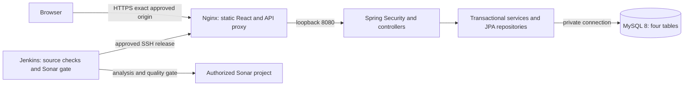

# Required submission completion

AWS is the only waiver. Pagination, testing seed data, Sonar, Jenkins, non-AWS deployment, protection and genuine submission artifacts are REQUIRED. This package implements bounded local work; external execution is not certified. Baseline main is aa8d2b9c7e2ee43b20b88fc895a613f12d18c8e7; changes remain uncommitted. Earlier records are historical for their exact revisions.

## Pagination contract and decision record

We kept the four entities and 24 business operations. GET /api/users, /api/rooms, /api/tasks and /api/rooms/{id}/inspections now always return `{items,page,size,totalElements,totalPages}`. Defaults are zero-based page=0, size=20; size accepts 1-100, page accepts 0-1000000. Invalid numbers/bounds/status return 400; empty datasets return items=[], totalElements=0, totalPages=0. An out-of-range page returns empty items with its requested page and unchanged authorized totals. No client owner/actor/role/sort parameter controls visibility.

Task order is id DESC, room order roomNumber ASC then id ASC, user order name ASC then id ASC, history order id DESC. Tasks optionally accept status=ASSIGNED/IN_PROGRESS/COMPLETED/CANCELLED. USER task rows and count share the assigned-user predicate derived from authenticated identity. MANAGER user rows and count share role=USER. Room/history reads retain the supervisor and room-existence gates. Page mapping stays inside the service read transaction. Existing write transactions and login/logout locks are preserved.

This is an intentional breaking list-response change: update old clients from array to envelope.items. No unbounded HTTP compatibility mode exists. The frontend primary task/room/team tables request server pages and offer Previous/Next controls with scoped totals; task filter changes reset page to zero. Controls are blocked during pending or unreconciled writes. History display has usable page controls; its bounded server pages are collected for lost-inspection-response reconciliation.

Dashboard and supervisor choice lists traverse all authorized size-100 pages rather than infer counts from one page. Changing totals or duplicate ids fail safely and invite reload. This is the smallest strategy without a new count/Analytics operation. It uses more requests on large datasets and is not an atomic multi-request snapshot; equal-total concurrent edits are not detected. It is appropriate for the current small capstone and no benchmark claim is made. Backend page totals themselves are computed from the authorized query.

## Testing seed: execution pending approval

[seed-test.sql](../database/seed-test.sql) supplies two synthetic accounts (MANAGER/USER), three rooms, three tasks and two retained PASS/FAIL inspections. T101 has ASSIGNED work and DIRTY room, T102 COMPLETED/PASS/READY, T103 COMPLETED/FAIL/DIRTY. Foreign keys, completion timestamps and inspector roles are consistent. No ADMIN/default credential is shipped; private first-ADMIN bootstrap remains separate.

[safe runner](../scripts/seed-test.cjs) requires the exact loopback hardening URL, private disposable credentials and private runtime BCrypt hashes (cost 10-16). Its MySQL connection hardcodes rockey_hospitality_hardening and SQL checks SELECT DATABASE through DATABASE(), empty tables and hash shape before data insertion. It does not delete/overwrite data. Serializable empty-range locks coordinate the empty-table guard; inserts commit together. Batch errors stop the client and connection, rolling back before COMMIT. Do not run the SQL interactively with SOURCE or mysql --force.

Privately configure ROCKEY_DB_URL, ROCKEY_DB_USERNAME, ROCKEY_DB_PASSWORD, ROCKEY_SEED_WORKER_HASH, ROCKEY_SEED_MANAGER_HASH and optionally ROCKEY_MYSQL_PATH. Credentials/hashes must come from runtime input, never tracked files or CLI arguments. `node scripts/seed-test.cjs --dry-run` validates input without connecting. Only after explicit write approval and an initialized empty disposable four-table schema: `node scripts/seed-test.cjs`. No seed execution occurred. Existing refusal of live hardening reset remains in effect; no new approval is assumed. Three Node input-safety tests and static FK/status checks are distinct from MySQL execution.

### Seed verification and live hardening are separate operations

Neither operation may target the demo database (rockey_hospitality_demo) or any deployed database. Both code paths hard-require rockey_hospitality_hardening on 127.0.0.1:3306, but the operator must still confirm the target is disposable before each run.

1. **Seed verification (own approval).** Requires explicit write approval for an empty, disposable rockey_hospitality_hardening schema created from database/schema.sql. Before running, confirm read-only that `SELECT DATABASE()` returns rockey_hospitality_hardening and all four tables have zero rows. Run `node scripts/seed-test.cjs --dry-run`, then `node scripts/seed-test.cjs`. Then inspect with read-only queries and record the results before doing anything else:
   - row counts: users 2, rooms 3, tasks 3, inspections 2; `SELECT COUNT(*) FROM users WHERE role='ADMIN'` = 0;
   - FK joins: every task joins a user and a room, and every inspection joins its room, task and a MANAGER inspector, with each inspection's task belonging to the same room;
   - status consistency: T101 DIRTY with an ASSIGNED task; T102 READY with a COMPLETED task and a PASS inspection; T103 DIRTY with a COMPLETED task and a FAIL inspection; every COMPLETED task has completed_at set and every other task has it NULL;
   - hashes: check `LEFT(password_hash,4)` and `LENGTH(password_hash)=60` only; never select or log full hash values.
   A refused or failed run must leave all four tables empty; confirm that with counts.
2. **Live hardening (separate explicit reset approval).** `HousekeepingMySqlTest` deletes all rows from inspections, tasks, rooms and users before every test (`@BeforeEach`) and inserts its own fixtures. Seeded rows do not survive and must not be treated as present afterward. It also requires the performance_schema lock-wait read permissions noted above. Run only with ROCKEY_HARDENING_LIVE=true after the reset approval names this database.
3. **Re-seeding after hardening** requires another explicit reset of the disposable schema, because the seed never deletes and refuses non-empty tables.

## Required external services and exact access

| Service | Available evidence | Required access / approval |
|---|---|---|
| SonarQube/SonarCloud | User confirms no project URL/key. Token presence is not an authorized environment. | Select authorized service, actual host/project, private analysis credentials and applicable permission/cost approval. If SonarCloud is proposed, obtain instructor acceptance as the SonarQube substitute. No waiver requested. |
| Jenkins | User confirms no server/agent. | Approve existing access or server/agent setup, with any installation/resource cost. Linux agent Java 17, supported Node 22.12+ or 24+, npm, Python3, Git, Bash, tar, curl, sha256sum and SSH. |
| Jenkins integration | Local [Jenkinsfile](../Jenkinsfile), NOT RUN | Configure SCM/multibranch job, agent label rockey-java17-node22-linux, Sonar server name rockey-sonar, webhook /sonarqube-webhook/ and token in Jenkins credentials. Required plugins: Pipeline, Git, JUnit, Sonar scanner, Credentials Binding/SSH credentials. No plugin installation performed. |
| Hosting/MySQL/TLS | Local MySQL 8/demo only; no approved hosting/domain | Approve account, region, Linux host/plan/cost, MySQL 8 location/private connectivity and least-privilege DB account, public hostname, TLS ownership and private secret handling. Actual frontend/backend URLs remain unavailable. |
| GitHub protection/publication | Current main matches baseline; protected=false, no actual check/status contexts | Approve reviewed source publication and settings separately. Proposed policy below uses no nonexistent checks. |

After Sonar access exists, choose process-local Java 17, set ROCKEY_HARDENING_LIVE=false and privately configure SONAR_TOKEN/SONAR_HOST_URL; run `.\mvnw.cmd verify org.sonarsource.scanner.maven:sonar-maven-plugin:sonar "-Dsonar.projectKey=<actual-approved-key>" "-Dsonar.sources=src/main/java,frontend/src" "-Dsonar.tests=src/test/java,frontend/src/tests" "-Dsonar.exclusions=frontend/src/tests/**" "-Dsonar.javascript.lcov.reportPaths=frontend/coverage/lcov.info"`. Capture exact commit or dirty-source fingerprint, sanitized report-task.txt task/analysis ids, gate and major/critical/security findings. Do not expose the token or substitute legacy results. Manual coverage must precede analysis; Jenkins already enforces this ordering and rejects a failing quality gate.

The pipeline checks out source; verifies backend/tests/coverage and packages the JAR; runs frontend tests/coverage/lint/typecheck/build sequentially; checks contracts/seed safety; scans both Java/frontend and waits for the Sonar gate; packages a revision-bearing checksummed release; and offers an explicit approval-gated deployment stage only on main. The host/user/key are configured through Jenkins private credentials (rockey-deploy-ssh), not source. Deployment is disabled by default. This is Jenkins configuration, not a successful Jenkins build. No platform substitution is claimed. A different CI platform requires specific instructor replacement approval plus resource/deployment approval.

## Proposed deployment and rollback

Smallest compatible proposal: one approved Linux host with Nginx terminating TLS and serving Vite static output; /api and secured /v3/api-docs proxy to the loopback Spring Boot process. MySQL 8 uses private/loopback connectivity. This topology needs no cross-site refresh cookies or browser token persistence. It is a proposal, not existing infrastructure or a purchase.

Current architecture/ERD/component diagrams remain in [submission documentation](CAPSTONE_SUBMISSION.md); this diagram is explicitly proposed deployment.

Prepared [Nginx template](../deployment/nginx.conf.template), [service template](../deployment/rockey.service.template), [release uploader](../scripts/deploy-release.sh) and [activation/rollback script](../deployment/activate-release.sh) are not installed or executed. On an approved host, operator provisioning must first create the restricted service user, owned /opt/rockey paths, MySQL schema (new selected database only), /etc/rockey/rockey.env and trusted host key/TLS configuration. Preserve existing data; provisioning is separately approved. The activation command requires an existing valid release for automatic rollback, so the first deployment requires a reviewed operator bootstrap and smoke check before subsequent automated releases. Restart authorization uses narrowly scoped sudo. The activation script's only privileged command is `sudo -n /usr/bin/systemctl restart rockey.service` (activation and rollback). [rockey-deploy.sudoers.template](../deployment/rockey-deploy.sudoers.template) grants the deploy account exactly that argv with NOPASSWD and !requiretty for non-interactive SSH: no wildcard, shell, editor or other unit, and no broad sudo. Before creating a release directory or switching links, the script runs `sudo -n -l` for the same argv and refuses (exit 2) if the grant is absent. It never prompts. If the rollback restart fails, it reports that operator action is required. On the host, confirm that `command -v systemctl` is /usr/bin/systemctl, or change the script and template together; scripts/verify-submission.py enforces that they match. Also confirm that the deploy account cannot write rockey.service, its drop-ins, /etc/rockey or /etc/sudoers.d. The restart grant runs only the release as the unprivileged rockey user. Installing the sudoers file (visudo -cf, root:root 0440) is a host-permission change and requires explicit approval. Local evidence covers only sandboxed shims for no grant, healthy activation, failed restart, failed readiness and failed rollback restart. No sudoers syntax check (visudo is unavailable on this machine), real host, or real systemd behavior has been verified. Install the script as /opt/rockey/bin/activate-release with LF line endings (enforced for `*.sh` by .gitattributes). Jenkins `BRANCH_NAME` is set only for multibranch jobs; a single-branch job never reaches the deployment stage.

Build frontend with public VITE_API_BASE_URL=/api. Private backend environment contains DB URL/user/password, standard-Base64 JWT key and exact ROCKEY_CORS_ALLOWED_ORIGINS=https://<approved-hostname>. Secure refresh cookie=true, SameSite=Lax, HttpOnly and existing /api/auth path remain. Backend binds 127.0.0.1, forwarded headers are trusted only from that loopback proxy. Expose only HTTPS/redirect and restricted administration ports; never expose MySQL/backend directly. Store secrets outside the release, operator-owned 0600; application-readable through the approved service group/credential facility. Do not use sudo/cat to display them during demos. No origin/domain is invented here.

Initial provisioning approval must name the account/host/cost, DB target, DNS/TLS changes, service installation and intended public exposure. Then render Nginx variables selectively, run nginx -t, install reviewed service/config and stage the tested first artifact. Do not point schema.sql at a populated database. After initial verification, Jenkins can upload future approved clean-source releases to /opt/rockey/incoming; activation validates archive paths, checksums and revision, switches current atomically and restarts the service. On restart/readiness failure it restores the previous application release. No schema change/reset occurs during deployment or rollback. Keep the prior release and private configuration.

Post-deployment verification is REQUIRED and NOT RUN: actual frontend HTTPS URL and backend /api URL; login/logout/refresh; protected anonymous endpoints return 401, wrong role/owner denial; paginated list totals and bounds; approved fixture cleaning/start/complete/PASS/FAIL/history; mobile/desktop themes and keyboard/modal/pending/uncertain-write cases. Verify cookie Secure/HttpOnly/SameSite/Path, exact CORS/Origin and TLS. Backend 401 at /api/auth/me is only a readiness signal, not full functionality proof. Rollback must rerun frontend/backend/version and protected-endpoint checks.

## Protection policy pending settings approval

Read-only main metadata shows protected=false; no check-runs or commit-status contexts exist on the audited SHA. [proposed protection payload](../deployment/main-protection.proposed.json) requires one approval, dismisses stale reviews, resolves conversations, enforces administrators and prohibits force pushes/deletion. required_status_checks is null because no actual checks exist. It does not claim CI merge enforcement.

Only after explicit settings approval, apply the reviewed payload with `gh api --method PUT repos/Neem3995/rockey-hospitality/branches/main/protection --input deployment/main-protection.proposed.json`, then read protection/rules/effective branch metadata. After Jenkins genuinely publishes a successful GitHub check/status, read its exact context/app id on the candidate SHA and separately approve adding that actual check as required. Do not configure a guessed Jenkins context. Configuring Jenkins status publication itself needs authorized credentials/integration.

## Final materials and shortest path

The local seven-slide nine-minute [editable deck](submission/ROCKEY_Required_Submission_Final.pptx) and [matching PDF](submission/ROCKEY_Required_Submission_Final.pdf) use existing branding, notes and the explicitly historical safe task screenshot. PPTX package/layout/import and every slide render were checked. On 2026-10-12 slide 4 gained a visible caption stating the screenshot predates pagination; the deck was then opened in desktop PowerPoint, all seven slides were exported as 1280x720 renders and visually reviewed, and the PDF was rebuilt from those renders with ReportLab. The PDF is image-only (no searchable text; accessibility not checked); native PowerPoint PDF export was not used. Actual rehearsal is NOT RUN. Existing presentation versions were preserved. Outline: problem 1m, architecture/model 1.5m, prepared demo 3m, history/denial 1m, transactions/ownership/testing 1.5m, lessons/limitations 1m.

Next: approve/access Sonar and Jenkins plus hosting; approve disposable seed/live/Postman/browser fixtures only if needed (reset currently declined); run current-source scan/gate and Jenkins; review/publish source only with explicit approval; bootstrap/deploy approved topology and verify/rollback; configure actual effective protection/checks; deliver required external artifacts. User-owned evidence remains genuine two-peer feedback given/received/incorporated, shared final Jira/closed sprint, self-assessment, Canvas repository/docs/PDF/Postman receipts and deadline, and private demo-access delivery. No fabricated completion and no readiness certification.
